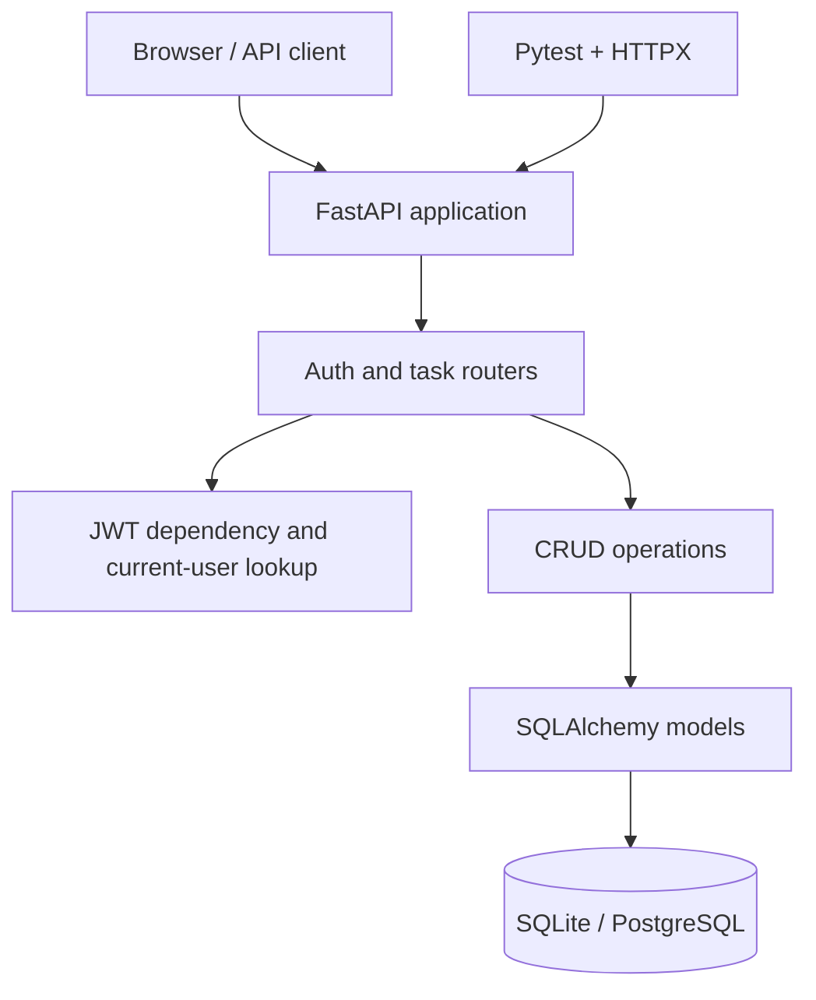

# TaskFlow API — Architecture

## Responsibilities
- **Routers:** HTTP endpoints, status codes, and request/response handling.
- **Dependencies/security:** bearer-token validation and authenticated-user resolution.
- **CRUD layer:** task persistence and owner-scoped queries.
- **Models/schemas:** relational mapping and input/output validation.
- **Database:** SQLAlchemy sessions against the configured database.

This diagram describes the current repository structure; it is not a claim of a separately deployed service.
