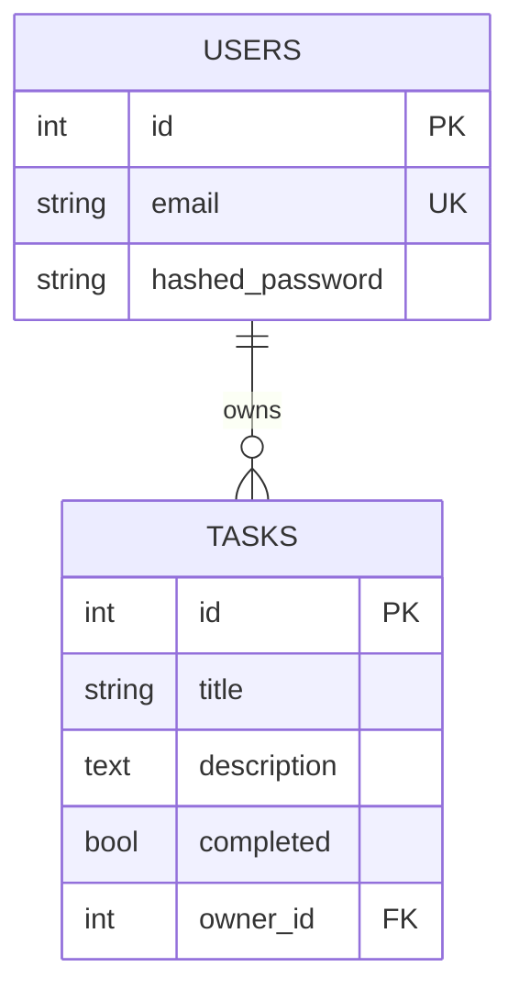

# TaskFlow API — Database ER Diagram

The diagram captures the user-to-task ownership relationship represented by the application models. Check `app/models.py` and Alembic migrations for the authoritative column definitions.
